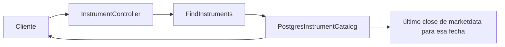
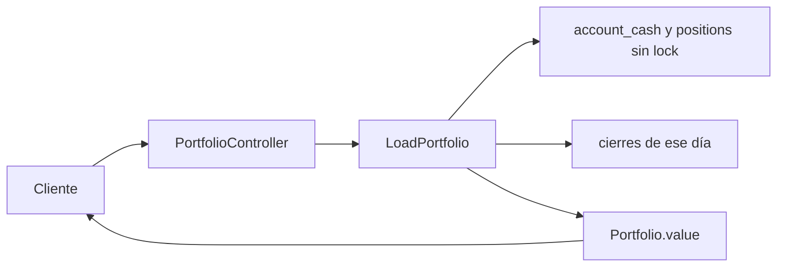
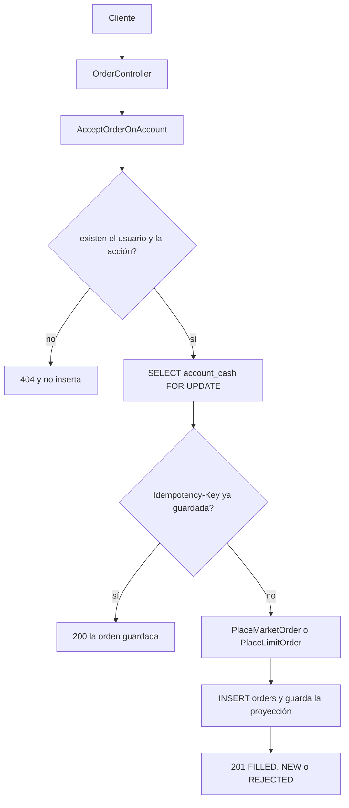
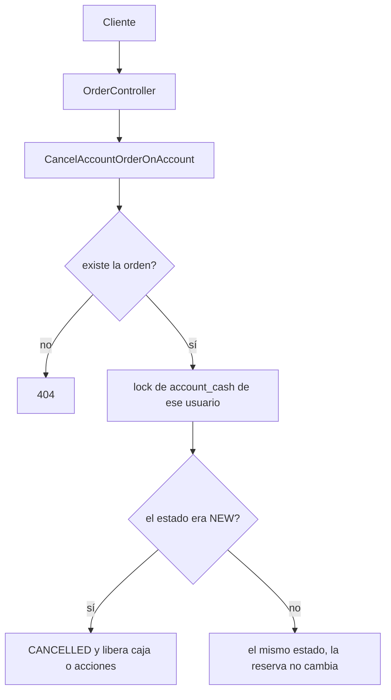
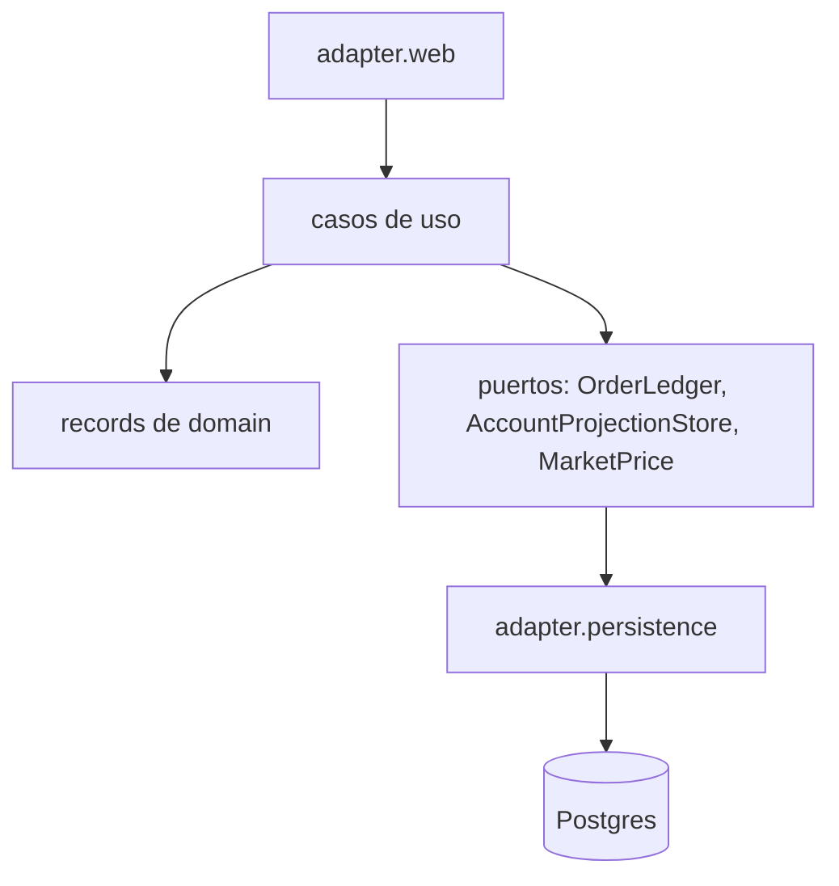

# Cocos Backend Challenge

[](https://github.com/LemonVinci/cocos-challenge-backend/actions/workflows/ci.yml)
[](https://github.com/LemonVinci/cocos-challenge-backend/actions/workflows/security.yml)


English version: [README.md](README.md).

API REST de una cuenta de inversión: valuación del portfolio, búsqueda de instrumentos y órdenes de acciones (`MARKET` / `LIMIT`, con cancelación). No hay autenticación ni matching. Los precios son `BigDecimal` en pesos. El día de mercado es la fecha de calendario del `datetime` del cliente en `America/Argentina/Buenos_Aires`: `2023-07-14T02:30:00Z` sigue siendo el 13 de julio.

`orders` es el libro. `account_cash` y `positions` son la proyección de ese libro, y se actualizan dentro del lock de la fila de esa cuenta. Un reintento con la misma `Idempotency-Key` devuelve la orden ya guardada y no vuelve a mover la caja.

## Por dónde empezar

| Qué | Dónde |
|---|---|
| El camino feliz por los controllers | `src/test/java/com/cocos/challenge/adapter/web/AccountFlowTest.java` |
| Ejecución a mercado, reserva límite y rechazo | `src/main/java/com/cocos/challenge/application/PlaceMarketOrder.java` y `PlaceLimitOrder.java` |
| Caja disponible y reserva de acciones | `src/main/java/com/cocos/challenge/domain/AccountCash.java` y `Position.java` |
| Valor del portfolio, rendimientos y la fórmula del corto | `src/main/java/com/cocos/challenge/domain/Portfolio.java` |
| El `SELECT … FOR UPDATE` por usuario | `src/main/java/com/cocos/challenge/adapter/persistence/PostgresAccounts.java` (`lockAccount`) |
| Idempotencia, después del lock y antes de insertar | `src/main/java/com/cocos/challenge/application/AcceptOrderOnAccount.java` |
| Tablas de la proyección y los índices que usan las consultas | `src/main/resources/db/migration/V2__account_projection.sql` y `V4__marketdata_latest_by_id.sql` |
| Replay del libro al arrancar | `src/main/java/com/cocos/challenge/application/RebuildProjection.java` |

## Contenido

- [Por dónde empezar](#por-dónde-empezar)
- [Arranque](#arranque)
- [API](#api)
- [Reglas de negocio](#reglas-de-negocio)
- [Arquitectura](#arquitectura)
- [Observabilidad](#observabilidad)
- [CI](#ci)
- [Estructura](#estructura)

## Arranque

Hace falta JDK 21. La clave de la base no está en el repo. `DB_URL` tiene que apuntar al host de Neon **sin** `-pooler`: Flyway toma un lock de sesión y el pooler no lo mantiene.

```bash
export DB_URL='jdbc:postgresql://HOST:5432/neondb?sslmode=require'
export DB_USERNAME='neondb_owner'
export DB_PASSWORD='***'
./mvnw spring-boot:run
```

Las mismas tres variables van en la configuración de Run de IntelliJ para `CocosChallengeApplication`. La API queda en `http://localhost:8080`.

```bash
curl -s localhost:8080/actuator/health
curl -s 'localhost:8080/portfolio?userId=1&datetime=2023-07-14T15:00:00-03:00'
```

Con las órdenes de la base, el usuario 1 (Emiliano) el 14 de julio de 2023 tiene `totalValue` 889756.00, `settledCash` 753000.00 y `availableCash` 627500.00, con posiciones en PAMP, METR y un corto en BMA.

La colección está en `postman/cocos-challenge.postman_collection.json`. `./mvnw test` no usa Neon: levanta un Postgres embebido y corre todas las migraciones, incluido el baseline.

## API

No hay autenticación. Un usuario desconocido, un instrumento desconocido o algo que no es una acción (`MONEDA`, ARS id 66) responde **404** y no escribe nada. Un rechazo de negocio se guarda `REJECTED` y responde **201**. El dinero en el JSON es un número, con escala 2 para la caja y los precios.

| Método | Ruta | Para qué |
|---|---|---|
| `GET` | `/instruments?ticker=&name=&datetime=` | Busca acciones. `datetime` es obligatorio. `ticker` y `name` son opcionales y se combinan con AND. |
| `GET` | `/portfolio?userId=&datetime=` | Caja liquidada, caja disponible y posiciones valuadas en ese día. |
| `POST` | `/orders` | Alta de `BUY` o `SELL`. Header opcional `Idempotency-Key` (máximo 64). |
| `POST` | `/orders/{id}/cancel` | Cancela una orden `NEW`. Una segunda cancelación no vuelve a liberar la reserva. |
| `GET` | `/actuator/health` | Proceso y base. `UP` es 200, `DOWN` es 503. |
| `GET` | `/actuator/metrics/{name}` | Timers y contadores de [Observabilidad](#observabilidad). |

`CASH_IN` y `CASH_OUT` existen solo como filas del libro sobre ARS. `POST /orders` los rechaza con **400**.

### `GET /instruments`



El controller convierte `datetime` en un día de mercado y llama al caso de uso de búsqueda. El repositorio hace un left join con la última fila de `marketdata` de ese instrumento y esa fecha (`ORDER BY id DESC LIMIT 1`). Un `%` al principio del filtro es literal, no un comodín.

Pedido: `GET /instruments?ticker=pamp&datetime=2023-07-14T15:00:00-03:00`

```json
[
  {
    "id": 47,
    "ticker": "PAMP",
    "name": "Pampa Energía",
    "type": "ACCIONES",
    "close": 925.85,
    "dailyReturn": 0.44
  }
]
```

`close` y `dailyReturn` van vacíos si ese día no tiene precio, o si `previousClose` es 0. Un `datetime` ausente o inválido es **400**.

### `GET /portfolio`



La lectura no toma el lock de la cuenta. `totalValue` es la caja liquidada más el valor de mercado de cada posición abierta. La caja reservada no se resta. Si alguna posición abierta no tiene cierre, `totalValue` va vacío.

Pedido: `GET /portfolio?userId=1&datetime=2023-07-14T15:00:00-03:00`

```json
{
  "userId": 1,
  "totalValue": 889756.00,
  "settledCash": 753000.00,
  "availableCash": 627500.00,
  "positions": [
    {
      "instrumentId": 47,
      "ticker": "PAMP",
      "quantity": 40,
      "marketValue": 37034.00,
      "totalReturn": -0.45,
      "dailyReturn": 0.44
    }
  ]
}
```

Un `userId` desconocido es **404**. Un usuario sin órdenes devuelve ceros y `positions` vacío.

### `POST /orders`



El controller mide la llamada completa, incluido el commit, en `account.transaction`. La espera del lock sola es `account.lock`. La búsqueda de la clave ocurre después del lock, así que dos reintentos del mismo usuario no pueden insertar los dos. Sin el header, cada llamada es una orden nueva.

`quantity` es la cantidad de acciones. `amount` es un monto en pesos y `size` queda en `floor(amount / price)`. Un tamaño 0 es `REJECTED`. Una límite necesita `price`.

```json
{
  "userId": 1,
  "instrumentId": 47,
  "side": "BUY",
  "type": "MARKET",
  "quantity": 1,
  "datetime": "2023-07-14T15:00:00-03:00"
}
```

```json
{
  "id": 12,
  "userId": 1,
  "instrumentId": 47,
  "side": "BUY",
  "type": "MARKET",
  "status": "FILLED",
  "size": 1,
  "price": 925.85,
  "datetime": "2023-07-14T15:00:00"
}
```

| Resultado | HTTP | Cuerpo |
|---|---|---|
| Market que se puede operar | 201 | `FILLED` al cierre de ese día |
| Limit que se puede reservar | 201 | `NEW` al precio límite |
| Sin caja o sin acciones disponibles, o tamaño 0 | 201 | `REJECTED`, la proyección no cambia |
| La misma `Idempotency-Key` | 200 | la primera orden, la caja no cambia |
| Usuario o instrumento desconocido, o ARS | 404 | no se inserta nada |
| `side` o `type` distintos de `BUY`/`SELL` o `MARKET`/`LIMIT`, o una clave de más de 64 | 400 | no se inserta nada |

Una venta en línea no puede abrir un corto. El replay del seed sí: la posición de BMA de Emiliano ya es negativa, y `ApplyBookOrder` confía en las filas `FILLED` guardadas.

### `POST /orders/{id}/cancel`



Solo el paso desde `NEW` libera la reserva. Una segunda cancelación del mismo id queda `CANCELLED` y no libera de nuevo. Cancelar una orden `FILLED` la deja `FILLED`.

### `GET /actuator/health`

Lo publica Spring Boot Actuator. `spring-boot-starter-actuator` está en el classpath y `management.endpoints.web.exposure.include` lista `health` y `metrics`, bajo el prefijo por defecto `/actuator`. No existe la ruta `/health`.

```json
{ "status": "UP" }
```

`UP` significa que el proceso está arriba y que el chequeo de la base pasó.

## Reglas de negocio

| Orden | Efecto en la proyección |
|---|---|
| `CASH_IN` `FILLED` | suma `size` a `settled_cash` (el precio es 1) |
| `CASH_OUT` `FILLED` | resta `size` de `settled_cash` |
| `BUY` `FILLED` | retira el nocional; suben la cantidad y `cost_basis` |
| `SELL` `FILLED` | deposita el nocional; baja la cantidad y el costo se reduce en proporción |
| `BUY` `LIMIT` `NEW` | reserva el nocional en `reserved_cash` |
| `SELL` `LIMIT` `NEW` | reserva `size` acciones |
| `REJECTED` | no cambia nada |
| Cancelar un `NEW` de compra | libera la caja reservada |
| Cancelar un `NEW` de venta | libera las acciones reservadas |

El nocional es `size × price`. `cost_basis` es el total de pesos de la cantidad abierta, no el promedio. El promedio es `cost_basis / quantity`. El rendimiento de un largo es `(marketValue − cost) / cost`. El de un corto es `(cost + marketValue) / cost`, porque el valor de mercado es negativo. Los porcentajes usan escala 8 y después dos decimales, half up. Sin cierre, el valor de mercado y el total del portfolio van vacíos.

Al arrancar, si las dos tablas de la proyección están vacías, las órdenes se recorren por `datetime`. Una `FILLED` guardada mueve la caja y la posición, también un límite ya ejecutado y un corto. Una `NEW` reserva. `REJECTED` y `CANCELLED` no cambian la foto, porque la reserva ya se liberó en el libro.

## Arquitectura



`domain` no usa Spring ni JDBC. `application` abre la transacción y decide la orden. `adapter.web` solo traduce el pedido. `adapter.persistence` es el único paquete que ejecuta SQL.

El lock de la cuenta es una fila: `SELECT settled_cash, reserved_cash FROM account_cash WHERE user_id = ? FOR UPDATE`. Si la fila no existe, se bloquea la fila del usuario y se inserta una caja en cero. Los demás usuarios no esperan. El portfolio y la búsqueda no toman ese lock. El aislamiento es `READ COMMITTED`.

Cada conexión pone `lock_timeout` en 1 s y `statement_timeout` en 2 s. Hikari espera como máximo 2 s una conexión y el pool es de 20. Los requests corren en virtual threads (`spring.threads.virtual.enabled=true`). Los saldos no se cachean: un cache viejo gastaría dos veces la misma caja.

Flyway marca `users`, `instruments`, `orders` y `marketdata` como baseline versión 1 y no las vuelve a crear en Neon. Las migraciones siguientes agregan la proyección, la clave de idempotencia y el índice de `marketdata` `(instrumentid, date, id DESC)`.

## Observabilidad

Actuator expone las métricas en el mismo puerto que la API.

| Métrica | Qué cuenta |
|---|---|
| `http.server.requests` | cada request, por método, plantilla de ruta, status y resultado |
| `account.lock` | el tiempo del `FOR UPDATE` |
| `account.transaction` | alta y cancelación, tag `operation=place\|cancel`, incluido el commit |
| `orders.accepted` | cada alta, tags `side`, `type`, `status`, `replayed` |
| `orders.cancelled` | cada cancelación, tags `status` y `released` |

Un 404 no suma `orders.accepted`. Los tags tienen poca cardinalidad: no van el `userId` ni la clave de idempotencia. `GET /actuator/metrics/orders.accepted` devuelve el contador. En este repo no hay scrape de Prometheus ni dashboard de Grafana; los números salen en el JSON de Actuator.

## CI

Los dos workflows corren en cada pull request y en cada push a `main`.

| Workflow | Qué hace |
|---|---|
| [CI](.github/workflows/ci.yml) | `./mvnw verify`. JaCoCo falla el build por debajo del 60 % de líneas, sin contar `CocosChallengeApplication`. El porcentaje queda en el resumen del job y, en un pull request, en un comentario que la corrida siguiente actualiza. El reporte HTML se sube como `jacoco-report`. |
| [Security](.github/workflows/security.yml) | Empaqueta el jar y corre Trivy (`vuln` y `secret`, `CRITICAL` y `HIGH`, ignora lo que no tiene fix). Una clave filtrada o un CVE grave de una dependencia falla el check. |

La última corrida verde en `main` midió **94,5 %** de líneas (770/815).

## Estructura

```text
src/main/java/com/cocos/challenge/
  domain/                 modelo y reglas, sin framework
  application/            casos de uso, transacción, idempotencia, métricas
  adapter/web/            controllers y cuerpos del pedido
  adapter/persistence/    JDBC, el lock de la fila, replay de arranque
src/main/resources/db/migration/
  V1__baseline_existing_schema.sql
  V2__account_projection.sql
  V3__order_idempotency.sql
  V4__marketdata_latest_by_id.sql
src/test/java/            tests de unidad y de API con Postgres embebido
postman/                  colección de Postman
.github/workflows/        ci.yml, security.yml
```
