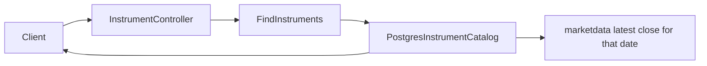
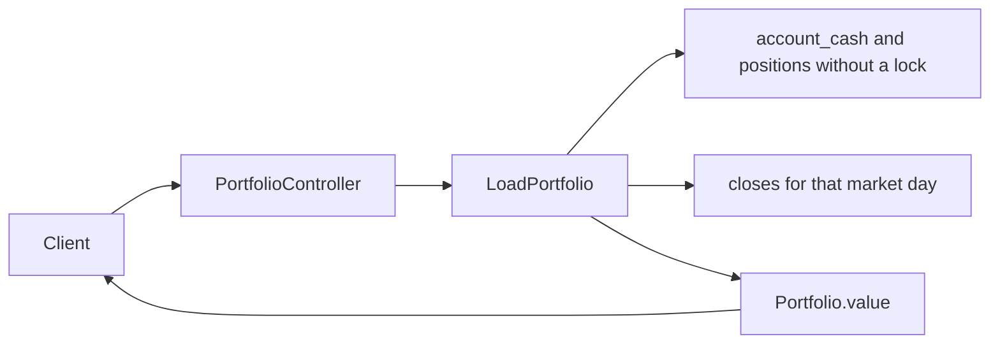
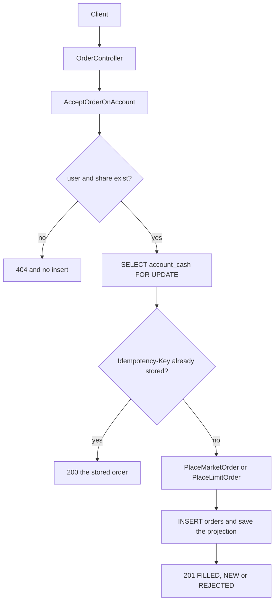
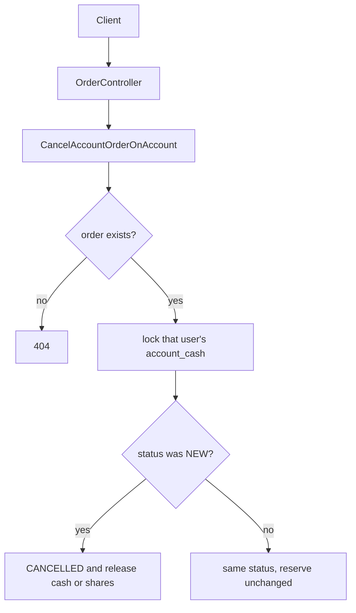
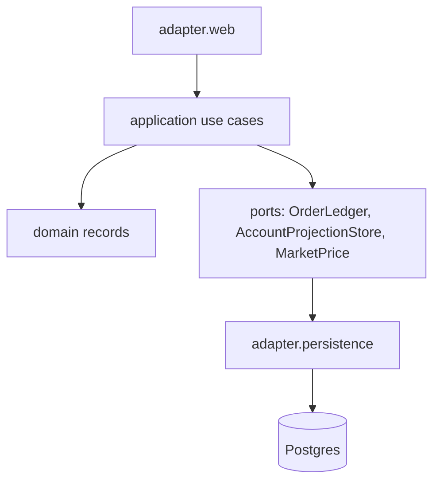

# Cocos Backend Challenge

[](https://github.com/LemonVinci/cocos-challenge-backend/actions/workflows/ci.yml)
[](https://github.com/LemonVinci/cocos-challenge-backend/actions/workflows/security.yml)


Versión en español: [README.es.md](README.es.md).

REST API for one brokerage account: portfolio valuation, instrument search, and share orders (`MARKET` / `LIMIT`, including cancellation). There is no authentication and no matching engine. Prices are ARS `BigDecimal`. The market day is the calendar date of the client `datetime` in `America/Argentina/Buenos_Aires`, so `2023-07-14T02:30:00Z` is still 13 July.

`orders` is the ledger. `account_cash` and `positions` are a projection of that ledger, updated inside a per-user row lock. A retry with the same `Idempotency-Key` returns the stored order and does not move cash again.

## Where to look first

| What | Where |
|---|---|
| The happy path through the controllers | `src/test/java/com/cocos/challenge/adapter/web/AccountFlowTest.java` |
| Market fill, limit reserve, and rejection | `src/main/java/com/cocos/challenge/application/PlaceMarketOrder.java` and `PlaceLimitOrder.java` |
| Available cash and share reservations | `src/main/java/com/cocos/challenge/domain/AccountCash.java` and `Position.java` |
| Portfolio value, returns, and the short formula | `src/main/java/com/cocos/challenge/domain/Portfolio.java` |
| The per-user `SELECT … FOR UPDATE` | `src/main/java/com/cocos/challenge/adapter/persistence/PostgresAccounts.java` (`lockAccount`) |
| Idempotency, after the lock and before a new insert | `src/main/java/com/cocos/challenge/application/AcceptOrderOnAccount.java` |
| Projection tables and the indexes the queries use | `src/main/resources/db/migration/V2__account_projection.sql` and `V4__marketdata_latest_by_id.sql` |
| Startup replay of the existing ledger | `src/main/java/com/cocos/challenge/application/RebuildProjection.java` |

## Contents

- [Where to look first](#where-to-look-first)
- [Quick start](#quick-start)
- [API](#api)
- [Business rules](#business-rules)
- [Architecture](#architecture)
- [Observability](#observability)
- [CI](#ci)
- [Project structure](#project-structure)

## Quick start

JDK 21. The database password is not in the repo. Point `DB_URL` at the Neon host **without** `-pooler`: Flyway takes a session lock, and the pooler does not keep it.

```bash
export DB_URL='jdbc:postgresql://HOST:5432/neondb?sslmode=require'
export DB_USERNAME='neondb_owner'
export DB_PASSWORD='***'
./mvnw spring-boot:run
```

The same three variables go in the IntelliJ run configuration of `CocosChallengeApplication`. The API listens on `http://localhost:8080`.

```bash
curl -s localhost:8080/actuator/health
curl -s 'localhost:8080/portfolio?userId=1&datetime=2023-07-14T15:00:00-03:00'
```

With the shipped orders, user 1 (Emiliano) on 14 July 2023 has `totalValue` 889756.00, `settledCash` 753000.00 and `availableCash` 627500.00, with positions in PAMP, METR and a short BMA.

Import `postman/cocos-challenge.postman_collection.json`. `./mvnw test` does not use Neon: it starts an embedded Postgres and runs every migration, including the baseline.

## API

No auth. An unknown user, an unknown instrument, or a non-share (`MONEDA`, ARS id 66) is **404** and writes nothing. A business rejection is stored as `REJECTED` and returns **201**. Money in JSON is a number, scale 2 for cash and prices.

| Method | Path | Purpose |
|---|---|---|
| `GET` | `/instruments?ticker=&name=&datetime=` | Search shares. `datetime` is required. `ticker` and `name` are optional and combined with AND. |
| `GET` | `/portfolio?userId=&datetime=` | Settled cash, available cash, and positions valued on that market day. |
| `POST` | `/orders` | Place a `BUY` or `SELL`. Optional header `Idempotency-Key` (max 64). |
| `POST` | `/orders/{id}/cancel` | Cancel a `NEW` order. A second cancel does not release the reserve again. |
| `GET` | `/actuator/health` | Process and database. `UP` is 200, `DOWN` is 503. |
| `GET` | `/actuator/metrics/{name}` | Timers and counters described under [Observability](#observability). |

`CASH_IN` and `CASH_OUT` exist only as ledger rows on ARS. `POST /orders` rejects them with **400**.

### `GET /instruments`



The controller parses `datetime` into a market day and calls the search use case. The repository left-joins the latest `marketdata` row for that instrument and date (`ORDER BY id DESC LIMIT 1`). A leading `%` in the filter is a literal, not a wildcard.

Request: `GET /instruments?ticker=pamp&datetime=2023-07-14T15:00:00-03:00`

```json
[
  {
    "id": 47,
    "ticker": "PAMP",
    "name": "Pampa Energía",
    "type": "ACCIONES",
    "close": 925.85,
    "dailyReturn": 0.44
  }
]
```

`close` and `dailyReturn` are null when that day has no price, or when `previousClose` is 0. A missing or unparseable `datetime` is **400**.

### `GET /portfolio`



Reads do not take the account lock. `totalValue` is settled cash plus each open position's market value. Reserved cash is not subtracted. If any open position has no close, `totalValue` is null.

Request: `GET /portfolio?userId=1&datetime=2023-07-14T15:00:00-03:00`

```json
{
  "userId": 1,
  "totalValue": 889756.00,
  "settledCash": 753000.00,
  "availableCash": 627500.00,
  "positions": [
    {
      "instrumentId": 47,
      "ticker": "PAMP",
      "quantity": 40,
      "marketValue": 37034.00,
      "totalReturn": -0.45,
      "dailyReturn": 0.44
    }
  ]
}
```

Unknown `userId` is **404**. A user with no orders returns zeros and an empty `positions` list.

### `POST /orders`



The controller times the whole call, including the commit, as `account.transaction`. The lock wait alone is `account.lock`. The idempotency lookup runs after the lock, so two retries of the same user cannot both insert. A missing key keeps one new order per call.

`quantity` is the share count. `amount` is an ARS budget and `size` becomes `floor(amount / price)`. Size 0 is `REJECTED`. A limit needs `price`.

```json
{
  "userId": 1,
  "instrumentId": 47,
  "side": "BUY",
  "type": "MARKET",
  "quantity": 1,
  "datetime": "2023-07-14T15:00:00-03:00"
}
```

```json
{
  "id": 12,
  "userId": 1,
  "instrumentId": 47,
  "side": "BUY",
  "type": "MARKET",
  "status": "FILLED",
  "size": 1,
  "price": 925.85,
  "datetime": "2023-07-14T15:00:00"
}
```

| Outcome | HTTP | Body |
|---|---|---|
| Market order that can trade | 201 | `FILLED` at that day's close |
| Limit order that can reserve | 201 | `NEW` at the limit price |
| Not enough available cash or shares, or size 0 | 201 | `REJECTED`, projection unchanged |
| Same `Idempotency-Key` | 200 | the first order, cash unchanged |
| Unknown user, unknown instrument, or ARS | 404 | nothing inserted |
| `side` or `type` not `BUY`/`SELL` or `MARKET`/`LIMIT`, or a key longer than 64 | 400 | nothing inserted |

A live sell cannot open a short. Replaying the seed can: Emiliano's BMA position is already negative, and `ApplyBookOrder` trusts the stored `FILLED` rows.

### `POST /orders/{id}/cancel`



Only the transition from `NEW` releases the reserve. A second cancel of the same id stays `CANCELLED` and does not release again. Cancelling a `FILLED` order leaves it `FILLED`.

### `GET /actuator/health`

Spring Boot Actuator publishes this. `spring-boot-starter-actuator` is on the classpath and `management.endpoints.web.exposure.include` lists `health` and `metrics`, under the default `/actuator` base path. There is no `/health` route.

```json
{ "status": "UP" }
```

`UP` means the process is running and the datasource check passed.

## Business rules

| Order | Effect on the projection |
|---|---|
| `CASH_IN` `FILLED` | adds `size` to `settled_cash` (price is 1) |
| `CASH_OUT` `FILLED` | subtracts `size` from `settled_cash` |
| `BUY` `FILLED` | withdraws the notional; quantity and `cost_basis` increase |
| `SELL` `FILLED` | deposits the notional; quantity decreases and cost is reduced in proportion |
| `BUY` `LIMIT` `NEW` | reserves the notional in `reserved_cash` |
| `SELL` `LIMIT` `NEW` | reserves `size` shares |
| `REJECTED` | no effect |
| Cancel a `NEW` buy | releases the reserved cash |
| Cancel a `NEW` sell | releases the reserved shares |

Notional is `size × price`. `cost_basis` is the total pesos of the open quantity, not the average. The average is `cost_basis / quantity`. A long return is `(marketValue − cost) / cost`. A short return is `(cost + marketValue) / cost`, because market value is negative. Percentages use scale 8 and then two decimals, half up. A missing close makes market value and the portfolio total empty.

On startup, if both projection tables are empty, orders are replayed by `datetime`. A stored `FILLED` moves cash and the position, including an already filled limit and a short. A stored `NEW` reserves. `REJECTED` and `CANCELLED` are no-ops, because the reserve was already released in the ledger.

## Architecture



`domain` has no Spring and no JDBC. `application` opens the transaction and decides the order. `adapter.web` only translates the request. `adapter.persistence` is the only package that runs SQL.

The account lock is one row: `SELECT settled_cash, reserved_cash FROM account_cash WHERE user_id = ? FOR UPDATE`. If the row is missing, the user row is locked and a zero cash row is inserted. Other users do not wait. Portfolio and search do not lock. Isolation is `READ COMMITTED`.

Each connection sets `lock_timeout` to 1s and `statement_timeout` to 2s. Hikari waits at most 2s for a connection and keeps 20. Requests run on virtual threads (`spring.threads.virtual.enabled=true`). Balances are not cached: a stale cache would double-spend.

Flyway baselines the provided `users`, `instruments`, `orders` and `marketdata` as version 1 and does not recreate them on Neon. Later migrations add the projection, the idempotency key, and the market-data index `(instrumentid, date, id DESC)`.

## Observability

Actuator exposes the meters on the same port as the API.

| Meter | What it counts |
|---|---|
| `http.server.requests` | every request, by method, route template, status and outcome |
| `account.lock` | time spent in the `FOR UPDATE` section |
| `account.transaction` | place and cancel, tag `operation=place\|cancel`, including the commit |
| `orders.accepted` | each placement, tags `side`, `type`, `status`, `replayed` |
| `orders.cancelled` | each cancel, tags `status` and `released` |

A 404 does not increment `orders.accepted`. Tags stay low cardinality: no `userId` and no idempotency key. `GET /actuator/metrics/orders.accepted` returns the counter. There is no Prometheus scrape config and no Grafana dashboard in this repo; the numbers are the Actuator JSON.

## CI

Both workflows run on every pull request and on every push to `main`.

| Workflow | What it does |
|---|---|
| [CI](.github/workflows/ci.yml) | `./mvnw verify`. JaCoCo fails the build under 60% line coverage, excluding `CocosChallengeApplication`. The percentage is written to the job summary and, on a pull request, as a comment that the next run updates. The HTML report is uploaded as `jacoco-report`. |
| [Security](.github/workflows/security.yml) | Packages the jar and runs Trivy (`vuln` and `secret`, `CRITICAL` and `HIGH`, ignore unfixed). A leaked key or a severe dependency CVE fails the check. |

The last green run on `main` measured **94.5%** line coverage (770/815).

## Project structure

```text
src/main/java/com/cocos/challenge/
  domain/                 model and rules, no framework
  application/            use cases, transaction, idempotency, metrics
  adapter/web/            controllers and request bodies
  adapter/persistence/    JDBC, the row lock, startup replay
src/main/resources/db/migration/
  V1__baseline_existing_schema.sql
  V2__account_projection.sql
  V3__order_idempotency.sql
  V4__marketdata_latest_by_id.sql
src/test/java/            unit tests and embedded-Postgres API tests
postman/                  Postman collection
.github/workflows/        ci.yml, security.yml
```
